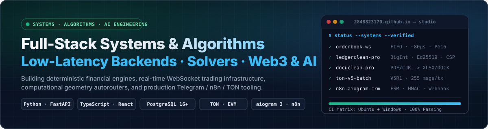

  

  <a href="https://2848823170.github.io/"><strong>🌐 Live Engineering Studio &amp; Demo Hub (2848823170.github.io)</strong></a>
  &nbsp;·&nbsp;
  <a href="https://2848823170.github.io/fastapi-ws-orderbook-demo/">OrderBook Terminal</a>
  &nbsp;·&nbsp;
  <a href="https://2848823170.github.io/ledgerclean-pro/">LedgerClean Pro</a>
  &nbsp;·&nbsp;
  <a href="https://2848823170.github.io/docuclean-pro/">DocuClean Pro</a>

---

### Live Interactive Systems & Commercial Tools

| System / Product | Architecture & Highlights | Live Application | Source & CI |
| :--- | :--- | :---: | :---: |
| **FastAPI Asyncio OrderBook & Signal Terminal** | Single-writer `asyncio.Queue` price-time priority (`FIFO`) matching engine (`~40–120 µs`), `EWMA` / `VWAP` / L2 book-imbalance signal stream, PostgreSQL 16+ range partitioning DDL, and dual-mode TypeScript WebSocket UI. | [**Launch Terminal ↗**](https://2848823170.github.io/fastapi-ws-orderbook-demo/) | [Source](https://github.com/2848823170/fastapi-ws-orderbook-demo)    |
| **LedgerClean Pro (`账清`)** | Zero-cloud local-first multi-platform payout, bank CSV (`GB18030` / `UTF-8-BOM`) & `N:1` subset-sum electronic voucher reconciler with exact `BigInt` micro-unit math, offline `Ed25519` licensing, and **Beancount** / QuickBooks / Excel exports. | [**Open Studio ↗**](https://2848823170.github.io/ledgerclean-pro/)   [*(50-Row Sandbox)*](https://2848823170.github.io/ledgerclean-pro/demo.html) | [CLI Repo](https://github.com/2848823170/ledgerclean-cli) · [Web](https://github.com/2848823170/ledgerclean-pro)    |
| **DocuClean Pro (`文档表格秒转引擎`)** | Offline multi-page PDF table stitching, HTML `rowspan`/`colspan` 2D grid flattening, automatic CJK mojibake recovery, formula/DDE sanitization, and styled OpenXML `.xlsx` & `.docx` generation (`connect-src 'none'`). | [**Open Converter ↗**](https://2848823170.github.io/docuclean-pro/)   [*(Full-Screen App)*](https://2848823170.github.io/docuclean-pro/demo.html) | [Source](https://github.com/2848823170/docuclean-pro) |

---

### Web3 Infrastructure & AI Workflow Automation

| Repository | Engineering Scope | CI Status |
| :--- | :--- | :---: |
| [**ton-v5-batch-sender**](https://github.com/2848823170/ton-v5-batch-sender) | Non-custodial **TON Wallet V5R1 (`WalletContractV5R1`)** bulk dispatcher packing up to **255 transfers per transaction** (`63.75x` fewer txs than V4R2), automatic `UQ...` / `EQ...` bounce inference, `--dry-run` fee simulation, sequential `seqno` polling, crash-safe JSONL checkpoints, and `HighloadWalletV3` / `USDT` Jetton (`0x0f8a7ea5`) architecture guide. |  |
| [**n8n-aiogram-lead-kit**](https://github.com/2848823170/n8n-aiogram-lead-kit)   [**[Live Playground ↗]**](https://2848823170.github.io/n8n-aiogram-lead-kit/) | Production **`aiogram 3` FSM + `FastAPI` Webhook Bridge + importable 7-node `n8n` Workflow JSON** (`EN`/`RU`), featuring deterministic `0–100` `HOT|WARM|COLD` lead scoring, inline Telegram Admin Triage cards, native Tilda + `HMAC-SHA256` webhook verification, and `amoCRM` / Google Sheets routing. |  |
| [**docuclean-ledger-mcp**](https://github.com/2848823170/docuclean-ledger-mcp)   [**[MCPize x402 ↗]**](https://mcpize.com/mcp/docuclean-ledger-mcp) · [**[Apify ↗]**](https://apify.com/shulang-chen/docuclean-ledger-mcp) | **Cloud-Hosted Model Context Protocol (`MCP`) Server & `x402` Base `USDC` Endpoint** (`stdio`, Streamable HTTP `/mcp`, SSE) exposing deterministic `BigInt` financial reconciliation (`N:1` subset-sum), multi-page PDF-to-`.xlsx` table extraction, and CJK CSV mojibake / DDE sanitization for Claude, Cursor, Windsurf, `n8n`, and autonomous `x402` agents. |  |

---

### Selected Open-Source Systems Contributions

- **Computational Geometry, Hypergraph & EDA Autorouting (`TypeScript` / `Bun`)**:
  - High-density PCB intra-node polyline & via-clearance constraint projection, BGA pad-channel topology filtering, sub-via port-point pathing splits, schematic net-label orientation solvers, 3D JSCAD footprint pipelines, and focus-isolated interactive canvas undo systems across `tscircuit/tscircuit-autorouter`, `tscircuit/core`, `tscircuit/schematic-trace-solver`, `tscircuit/pcb-viewer`, and `tscircuit/3d-viewer`.
- **On-Chain Supply & Vesting Forensics (`Node.js` / `Cosmos SDK` & `CosmWasm`)**:
  - Deterministic RPC supply & vesting-schedule verification (`pacific-1` bank supply, `code_id 5530` Gringotts linear-vesting smart contracts, paginated validator staking/unbonding reconciliation, and fail-closed RPC guards) in `tradermarketcap/tradermarketcap-open`.

---

### Core Engineering Capabilities

- **Backend & Real-Time Systems**: Python (`FastAPI`, `asyncio`, `aiogram 3`, `Pydantic v2`, `PyMuPDF`, `openpyxl`), Node.js / Bun, WebSockets, PostgreSQL 16+ declarative partitioning (`RANGE` / `BRIN`), REST & HMAC webhook bridges.
- **Frontend & Local-First Web**: TypeScript, React, HTML5 Canvas / SVG visualization, WebCrypto (`Ed25519`), strict-CSP zero-cloud single-file applications.
- **Web3 & AI Automation**: TON (`@ton/ton` V5R1, Highload V3, Jettons), EVM (`ethers` / `viem`), `n8n` custom pipelines, Model Context Protocol (`MCP`) servers, and deterministic AI agent skills.
